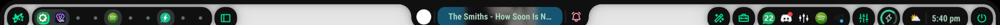

# Ambxst nativo + GreenBlack

La aplicación inicial se validó en Ambxst 1.3.7 sin mods activos, con la batería
original. Posteriormente actualicé a Ambxst 1.3.14 e instalé [Roadie 4.1.1](ambxst-roadie.md).
GreenBlack sigue siendo un preset nativo. Los mods locales Pentest y Battery
Indicator quedan archivados en el repo; el restore normal no los instala.

El preset vive en `.config/ambxst/colors/GreenBlack/{dark,light}.json`. En oscuro
comparte fondo `#101010`, texto `#a8d5bf` y acento `#00e69a` con Kitty y Spotify.
OLED está desactivado para que el fondo no se convierta en negro puro. Mantengo
los colores semánticos rojo/amarillo del preset nativo Catppuccin para avisos y
errores. La variante clara adapta fondos y texto para conservar contraste.

## Activar o restaurar

El restaurador copia los archivos explícitos del manifiesto; no lo ejecuto con
`--apply` desde Hyprland en uso. Tras restaurar configs:

1. Si estaban activos: `ambxst mods disable local.battery-indicator` y
   `ambxst mods disable local.pentest-mode`.
2. Ejecuto `ambxst reload` y abro `ambxst run wallpapers`.
3. En el selector de esquema elijo **GreenBlack**, modo oscuro y OLED apagado.
4. Si los bordes muestran el error de color del live reload de esta versión,
   ejecuto `hyprctl reload` y compruebo `hyprctl configerrors`.

Ambxst guarda la selección en `~/.cache/ambxst/wallpapers.json`, propiedad
`activeColorPreset`. Aunque esté bajo cache, ese archivo contiene las preferencias
de Wallpaper.qml. No versiono las rutas personales de wallpaper. El propio
Ambxst aplica el preset y genera colors.json, CSS GTK y la integración del
compositor; no edito esos outputs. Un preset activo mantiene la paleta al cambiar
wallpaper. Los JSON del preset son configuración, no un mod.

## Aplicaciones

- GTK 3/4: `adw-gtk3`, modo oscuro y colores del generador nativo. `gtk-4.0/gtk.css`
  es un archivo normal, ya no un enlace al tema Colloid: así el generador no
  sobrescribe archivos del tema original. El CSS versionado es un snapshot de
  lo generado por Ambxst, que puede regenerarlo. La preferencia guardada de
  nwg-look también usa adw-gtk3 para que su `-a` al iniciar no restaure Colloid.
  En `nwg-look/config`, `export-gtk4-symlinks=false` impide que vuelva a sustituir
  el CSS de Ambxst por un enlace al tema GTK.
- Qt: `.config/qt{5,6}ct/`, estilo Fusion y paleta GreenBlack. La variable
  `QT_QPA_PLATFORMTHEME=qt5ct:qt6ct` se establece en el entorno de Hyprland.
  Los paquetes ya estaban instalados; las rutas del esquema usan `~` y no mi
  usuario. Se configura solo el tema, sin forzar X11/Wayland. La paleta Qt es
  estática: si cambio a otro tema, la selecciono también en qt5ct/qt6ct.
- Kitty, Neovim y Spotify conservan sus configuraciones GreenBlack anteriores.
  Las aplicaciones abiertas pueden necesitar reiniciarse. Las lanzadas desde
  procesos que conservan el entorno anterior recibirán el nuevo entorno en la
  siguiente sesión. No cierro aplicaciones ni la sesión automáticamente.
  El lanzador nativo de Ambxst fuerza `qt6ct` en su propio proceso: una app Qt 5
  que herede ese valor puede necesitar lanzarse con
  `QT_QPA_PLATFORMTHEME=qt5ct:qt6ct <aplicación>`. No parcheo el lanzador.
- Discord, Java/Burp, páginas web y apps aisladas pueden imponer su propio tema.
  Este ajuste no modifica sus clientes ni garantiza recolorear todos sus elementos.

Qtct necesita listas `[ColorScheme]` de QPalette; no se usa `ambxst.colors`, que
esta versión genera en formato KDE. Se verificó la paleta real de Qt 5 (XCB),
Qt 6 (Wayland) y los tokens GTK 4. Qt 5 no tiene plugin Wayland instalado en esta
máquina; no se añadió ni se forzó ese backend. Los probes son temporales.
La expansión de `~` es nativa de [qt6ct](https://github.com/trialuser02/qt6ct/blob/master/src/qt6ct-common/qt6ct.cpp)
y se comprobó también en qt5ct instalado.

## Volver atrás

En Wallpapers elijo otro esquema nativo, por ejemplo **Tonal Spot**, que vuelve
a extraer colores del wallpaper. En qt5ct/qt6ct puedo desmarcar la paleta
personalizada y retirar `QT_QPA_PLATFORMTHEME` de `hypr/user/env.lua`.

El respaldo previo de esta aplicación está en
`~/.local/state/dotfiles-backups/green-black-native-20261027-173303/`.
No uso `mods rollback` para cambiar colores: podría reactivar los mods anteriores.
Para recuperar un mod, lo habilito expresamente y recargo; Pentest también
necesitaría restaurar su atajo si lo quiero usar.

## Comprobación del 27/10/2026

- Ambos mods deshabilitados; generación `base`, una instancia cargando el
  `shell.qml` original. Recarga estable durante más de la ventana de salud.
- Selección GreenBlack persistente tras recargar. Caché y CSS generados por
  Ambxst coinciden con los colores del preset; 98 roles válidos por variante.
- GTK 4 y probes Qt 5/6 leen fondo, texto y selección correctos. Contraste
  texto/fondo del preset: 11.72:1 en oscuro y 11.64:1 en claro.
- 15 pruebas del restaurador, manifiesto, sintaxis Lua y `git diff --check`
  correctos. Solo se ejecutó el plan del restore; su modo `--check` exige
  salir de Hyprland, por lo que no se aplicó la restauración general.
- `hyprctl configerrors` vacío después del reload. El source de Ambxst sigue
  limpio. Persisten warnings del source nativo (avatar/miniatura ausentes,
  CompactPlayer/GlobalStates y otros avisos QML); no se parchearon como parte
  de este cambio de tema.

